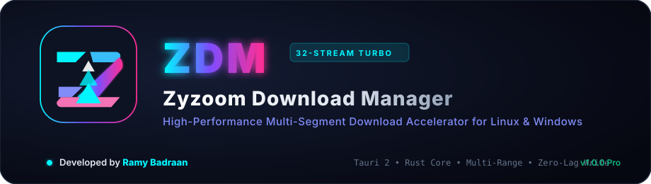

<div align="center">



# Zyzoom Download Manager (ZDM)
### مدير تحميل فائق السرعة — بديل عصري ومتفوق على Internet Download Manager
**Developed by Ramy Badraan**

[](#)
[](#)
[](#)
[](#)

</div>

---

## ⚡ لماذا يتفوق ZDM على Internet Download Manager (IDM)؟

| الميزة | Internet Download Manager (IDM) | Zyzoom Download Manager (ZDM) |
|---|---|---|
| **سرعة الانتهاء** | يعاني من تعليق وتوقف طويل عند 99% بسبب دمج الأجزاء المؤقتة | **Zero-Lag Write**: يكتب مباشرة في موضع البايت المحدد دون أي وقت دمج! |
| **تقنية التوازي** | ثابتة وغالباً ما يتعطل آخر جزء بمفرده | **Work Stealing**: إعادة تقسيم الجزء الأبطأ بين القنوات الحرة تلقائياً |
| **القنوات المتزامنة** | أقصى حد عملي محدود | **حتى 32 قناة متزامنة (Turbo Mode)** مع توفير استهلاك الشبكة |
| **استهلاك الذاكرة (RAM)** | قد يستهلك مئات الميغابايت مع الواجهات القديمة | **خفيف جداً (< 90MB RAM)** بفضل أمان وخفة لغة Rust |
| **دعم الأنظمة** | ويندوز فقط واحتكاري | **Cross-Platform**: يعمل بأداء أصلي كامل على Linux و Windows |
| **الواجهة وتجربة المستخدم** | واجهة Win32 من التسعينيات لا تدعم الشاشات الحديثة | **واجهة Cyberpunk عصرية**: Dark/Light، شريط مقاطع حي، ورسوم بيانية |
| **تحميل الفيديو والوسائط** | التقاط محدود قد يواجه مشاكل مع التحديثات | **محرك مدمج قوي** عبر yt-dlp لاستخراج أعلى الجودات (4K/8K/Audio) |

---

## 🏗️ المعمارية التقنية (Architecture)

```text
zdm/
├── assets/                  # الشعار والهوية البصرية والأيقونات عالية الدقة
├── apps/
│   ├── desktop/             # تطبيق سطح المكتب الرئيسي
│   │   ├── src/             # واجهة React 18 + TypeScript + Tailwind CSS
│   │   │   ├── components/  # DownloadCard, StatsCards, Modals...
│   │   │   ├── styles/      # متناغمة مع Cairo و JetBrains Mono
│   │   │   └── types/       # النماذج المشتركة
│   │   └── src-tauri/       # نواة Rust الفائقة السرعة
│   │       ├── src/
│   │       │   ├── engine/  # محرك التقسيم والكتابة المباشرة (Direct-Write)
│   │       │   ├── db/      # قاعدة بيانات SQLite للاستئناف الفوري
│   │       │   ├── video/   # مستخرج وسائط yt-dlp
│   │       │   ├── ipc/     # جسر TCP محلي على 127.0.0.1:46800
│   │       │   └── commands/# أوامر الواجهة (Tauri Commands)
│   ├── host/                # zdm-host (Native Messaging بـ Rust)
│   └── extension/           # إضافة المتصفح الرسمية (Manifest V3)
├── Cargo.toml               # Cargo Workspace
└── package.json             # Root Workspace
```

---

## 🚀 التشغيل والتطوير

### 1. المتطلبات:
- **Rust & Cargo** (v1.75+)
- **Node.js** (v18+) و **npm**
- مكتبات WebKitGTK على لينكس (`webkit2gtk-4.1`)

### 2. تشغيل التطبيق في وضع التطوير:
```bash
# تثبيت الحزم
npm --prefix apps/desktop install

# تشغيل بيئة التطوير (الواجهة + نواة Rust)
npm run dev
```

### 3. بناء النسخة الإنتاجية (Release Build):
```bash
npm run build
```

---

## 🧩 تثبيت إضافة المتصفح (Browser Extension)

1. افتح متصفحك (Chrome / Edge / Brave / Vivaldi) وانتقل إلى:
   `chrome://extensions/`
2. فعّل **وضع المطور (Developer mode)** في الزاوية العلوية.
3. اضغط على **تحميل حزمة غير مضغوطة (Load unpacked)**.
4. اختر مجلد `apps/extension` داخل المشروع.
5. سيتم ربط الإضافة تلقائياً بـ ZDM عبر الجسر المحلي `127.0.0.1:46800` لالتقاط الروابط والفيديوهات فوراً.

---

## ⚖️ حقوق الملكية والتطوير

تم تطوير وتصميم هذا البرنامج بالكامل بواسطة:
**Developed by Ramy Badraan**
جميع الحقوق محفوظة للمطور رامي بدران © 2026.
