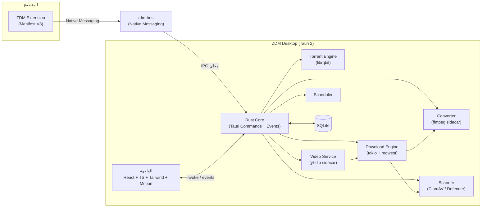
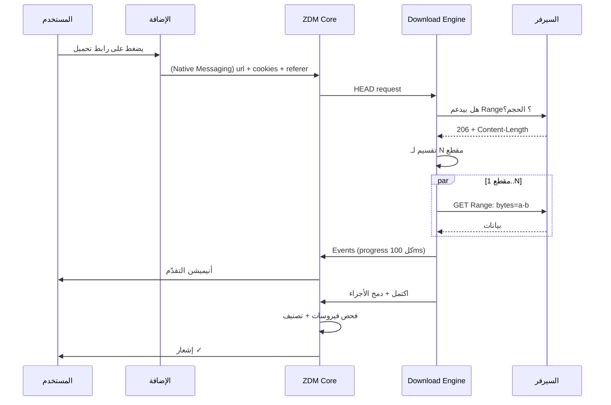
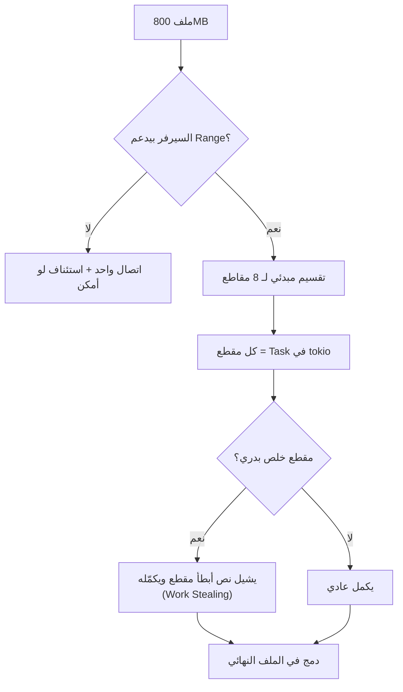
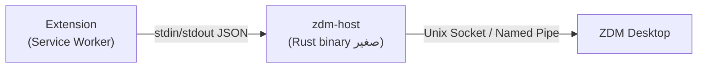
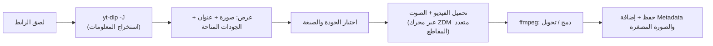
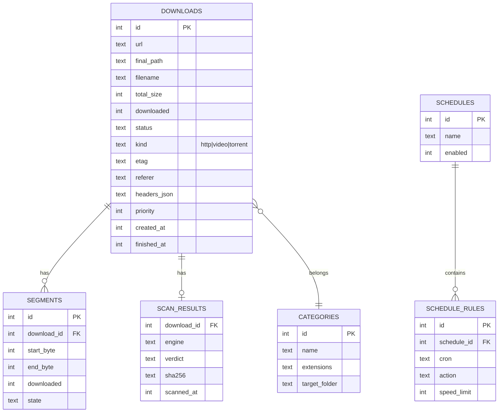
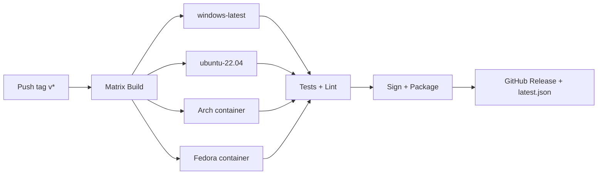
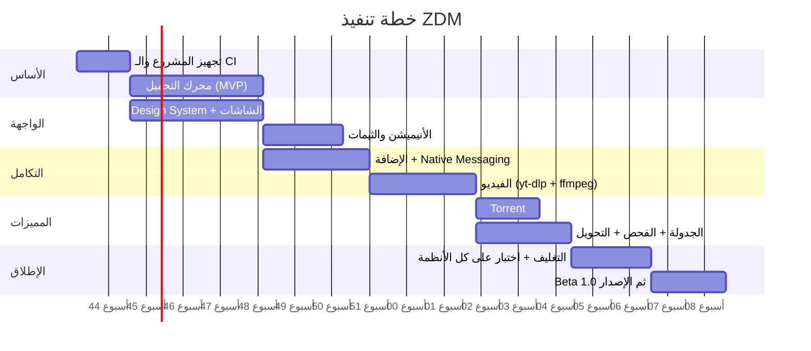

<div align="center">


# Zyzoom Download Manager (ZDM)

> وثيقة التصميم الأصلية. للحالة الفعلية والبناء والتثبيت راجع [`README.md`](README.md).
>
> **Original design document.** For the current implementation, build and install
> instructions see [`README.md`](README.md).
### خطة عمل كاملة — مدير تحميل عصري لـ Windows و Linux (Arch / Fedora / Debian)

`Tauri 2` · `Rust` · `TypeScript` · `Dark / Light` · `Browser Extension` · `yt-dlp` · `Torrent`

</div>

---

## فهرس المحتويات

1. [نظرة عامة على المشروع](#1-نظرة-عامة-على-المشروع)
2. [الهوية البصرية واللوجو](#2-الهوية-البصرية-واللوجو)
3. [نطاق المشروع والمميزات](#3-نطاق-المشروع-والمميزات)
4. [المعمارية العامة](#4-المعمارية-العامة)
5. [التقنيات المستخدمة](#5-التقنيات-المستخدمة)
6. [محرك التحميل وكيف يسرّع التحميل](#6-محرك-التحميل-وكيف-يسرّع-التحميل)
7. [تصميم الواجهة (UI/UX)](#7-تصميم-الواجهة-uiux)
8. [نظام الأنيميشن](#8-نظام-الأنيميشن)
9. [إضافة المتصفح](#9-إضافة-المتصفح)
10. [تحميل الفيديو من يوتيوب وغيره](#10-تحميل-الفيديو-من-يوتيوب-وغيره)
11. [Torrent / الجدولة / فحص الفيروسات / التحويل](#11-torrent--الجدولة--فحص-الفيروسات--التحويل)
12. [قاعدة البيانات والإعدادات](#12-قاعدة-البيانات-والإعدادات)
13. [هيكل المشروع](#13-هيكل-المشروع)
14. [التغليف والتوزيع على كل الأنظمة](#14-التغليف-والتوزيع-على-كل-الأنظمة)
15. [خطة التنفيذ (Roadmap)](#15-خطة-التنفيذ-roadmap)
16. [الاختبارات والجودة](#16-الاختبارات-والجودة)
17. [الأمان والخصوصية](#17-الأمان-والخصوصية)
18. [الاعتبارات القانونية وسياسات المتاجر](#18-الاعتبارات-القانونية-وسياسات-المتاجر)
19. [المخاطر وحلولها](#19-المخاطر-وحلولها)
20. [قائمة التسليم النهائية](#20-قائمة-التسليم-النهائية)

---

## 1. نظرة عامة على المشروع

**ZDM** برنامج تحميل متكامل (Download Manager) يشتغل على:

| النظام | الصيغ المدعومة |
|---|---|
| **Windows 10 / 11** | `.msi` · `.exe` (NSIS) · Portable `.zip` |
| **Debian / Ubuntu / Mint** | `.deb` |
| **Fedora / RHEL / openSUSE** | `.rpm` |
| **Arch / Manjaro / EndeavourOS** | `PKGBUILD` (AUR) · `.pkg.tar.zst` |
| **أي توزيعة Linux** | `.AppImage` · Flatpak (اختياري) |

### الهدف
- تجربة زي **IDM** لكن بواجهة عصرية جداً وأنيميشن سلس.
- يلقط روابط التحميل من المتصفح تلقائياً عن طريق **إضافة**.
- يحمّل فيديوهات يوتيوب (وآلاف المواقع التانية) بأي جودة.
- حجم صغير وأداء عالي بفضل **Tauri + Rust**.

### مبادئ التصميم
1. **السرعة أولاً:** تحميل متعدد المقاطع + استئناف + إعادة محاولة ذكية.
2. **الجمال:** واجهة Dark/Light مع أنيميشن بتحسّسك إن التحميل "حي".
3. **الخفة:** استهلاك رام قليل (هدف: < 120MB وقت التحميل النشط).
4. **كروس-بلاتفورم حقيقي:** نفس الكود والتجربة على كل الأنظمة.

---

## 2. الهوية البصرية واللوجو

<div align="center">

</div>

### فكرة اللوجو
اللوجو مبني على حرف **Z** (من Zyzoom) بس فيه فكرتين مخبّيين:

1. **شكل الـ Z نفسه = مسار الملف:** من فوق لتحت بخط قطري — يعني "سرعة وانحدار" نحو الجهاز (Download).
2. **التلات شرايط تحت الـ Z = التقسيم المتوازي (Segments):** دي فكرة سرعة البرنامج الأساسية — الملف بيتقسم على أجزاء وبتتحمل في نفس الوقت. درجة شفافية الشرايط بتقل (١٠٠٪ ← ٦٥٪ ← ٣٥٪) فتديك إحساس بالحركة واتجاه التقدّم.
3. **التدرّج اللوني (بنفسجي ← سيان):** بنفسجي = الحماس والتقنية، سيان = السرعة والتدفق.

### نسخ اللوجو

| الاستخدام | الملف |
|---|---|
| أيقونة التطبيق / الـ Tray / الـ Favicon | `assets/logo.svg` |
| اللوجو الكامل مع الاسم | `assets/logo-wordmark.svg` |
| أيقونة Tray أحادية اللون (Mono) | تتصدّر من نفس الـ SVG — أبيض/أسود |

### نظام الألوان

| الاسم | Dark | Light | الاستخدام |
|---|---|---|---|
| Background | `#0B1020` | `#F4F6FF` | خلفية التطبيق |
| Surface | `#121933` | `#FFFFFF` | الكروت والشريط الجانبي |
| Surface-2 | `#1A2347` | `#EEF1FF` | حقول الإدخال والأزرار الثانوية |
| Border | `#263058` | `#DDE2F5` | الحدود |
| Text | `#E8ECFF` | `#12163A` | النص الأساسي |
| Muted | `#8B95C9` | `#6B7299` | النص الثانوي |
| **Accent 1** | `#7C3AED` | `#7C3AED` | بنفسجي (أساسي) |
| **Accent 2** | `#06B6D4` | `#06B6D4` | سيان (سرعة / تقدّم) |
| Success | `#22C55E` | `#16A34A` | اكتمل / آمن |
| Warning | `#F59E0B` | `#D97706` | تحذير / متوقف |
| Danger | `#EF4444` | `#DC2626` | فشل / ملف مشبوه |

**التدرّج الأساسي:** `linear-gradient(135deg, #7C3AED, #06B6D4)`

### الخطوط
- **الإنجليزي:** Inter (أو Geist).
- **العربي:** Cairo أو IBM Plex Sans Arabic.
- **الأرقام والسرعات:** JetBrains Mono (عشان الأرقام ما تهتزش وهي بتتغير).

---

## 3. نطاق المشروع والمميزات

### داخل النطاق (v1.0)

| المجموعة | الميزة |
|---|---|
| **أساسي** | تحميل متعدد المقاطع · إيقاف/استئناف · إعادة محاولة تلقائية · طابور تحميل · تحديد أقصى سرعة · تصنيف الملفات تلقائياً |
| **المتصفح** | إضافة لـ Chrome / Edge / Brave / Firefox · التقاط التحميلات · زر تحميل على الفيديوهات · قائمة كليك يمين |
| **الفيديو** | يوتيوب + مواقع كتير · اختيار الجودة · قوائم التشغيل كاملة · الترجمات · استخراج الصوت MP3 |
| **التحويل** | تحويل صيغ الفيديو والصوت (ffmpeg) بعد التحميل |
| **Torrent** | ملفات `.torrent` وروابط `magnet:` · اختيار الملفات · Seeding |
| **الجدولة** | بدء/إيقاف في أوقات محددة · أيام الأسبوع · "اقفل الجهاز بعد الانتهاء" |
| **الأمان** | فحص الملفات بعد التحميل (ClamAV / Windows Defender) + فحص الـ Hash اختيارياً |
| **الواجهة** | Dark / Light مع تبديل · أنيميشن · عربي + English (RTL/LTR) |

### خارج النطاق (حالياً)
- ❌ **المزامنة بين الأجهزة** (حسب طلبك).
- ❌ **التحكم عن بُعد من الموبايل** — كان مربوط بنفس الخيار، فاتشال معاه. ممكن نضيفه في v2 لو حبيت.
- ❌ macOS (ممكن لاحقاً — Tauri بيدعمه، بس مش مطلوب دلوقتي).

---

## 4. المعمارية العامة



### تدفق تحميل عادي



### مبدأ الفصل
- **الواجهة** ما بتعملش أي شغل تقيل — بتستقبل Events بس وتعرضها.
- **كل المنطق** في Rust: أمان أعلى، وأداء أفضل، والواجهة ما بتهنجش حتى لو فيه 100 تحميل.

---

## 5. التقنيات المستخدمة

### لماذا Tauri + Rust؟
| المقارنة | Tauri | Electron |
|---|---|---|
| حجم التثبيت | ~8–15 MB | ~100+ MB |
| استهلاك الرام | قليل | عالي |
| الأمان | Rust + صلاحيات محددة | Node كامل الصلاحيات |
| الأداء في الشبكة | ممتاز (tokio) | جيد |

### الـ Stack

| الطبقة | التقنية |
|---|---|
| الإطار | **Tauri 2.x** |
| اللغة الأساسية | **Rust** (stable) |
| الشبكة | `reqwest` + `hyper` + `rustls` (HTTP/1.1 و HTTP/2) |
| Async | `tokio` |
| قاعدة البيانات | `SQLite` عبر `sqlx` أو `rusqlite` |
| Torrent | `librqbit` (Rust بالكامل) |
| الفيديو | **yt-dlp** (Sidecar) |
| التحويل | **ffmpeg** (Sidecar) |
| الواجهة | **React 18 + TypeScript + Vite** |
| التنسيق | **Tailwind CSS** + CSS Variables للثيمات |
| الأنيميشن | **Motion (Framer Motion)** + Canvas/SVG للتحميل |
| إدارة الحالة | Zustand |
| الأيقونات | Lucide |
| الإضافة | Manifest V3 + TypeScript |
| CI/CD | GitHub Actions |

### Tauri Plugins مستخدمة
`single-instance` · `autostart` · `notification` · `updater` · `store` · `shell` (sidecar) · `fs` · `dialog` · `clipboard-manager` · `global-shortcut`

---

## 6. محرك التحميل وكيف يسرّع التحميل

> **نقطة صراحة مهمة:** مفيش برنامج يقدر يتخطى سرعة الإنترنت نفسها. اللي بيعمله IDM وZDM إنهم **يستغلوا السرعة المتاحة بالكامل**. التسريع الملحوظ بيحصل لما السيرفر بيحدّد سرعة كل اتصال لوحده (وده شائع جداً) — لأن 8 اتصالات بياخدوا 8 أضعاف.

### 6.1 التقسيم الديناميكي (Dynamic Segmentation)



**التفاصيل:**
- عدد المقاطع **تلقائي** حسب الحجم: `< 5MB → 1` · `< 100MB → 4` · `< 1GB → 8` · `≥ 1GB → 16` (والمستخدم يقدر يغيّر، حد أقصى 32).
- **Work Stealing:** لو مقطع خلص، بياخد نص الباقي من أبطأ مقطع. ده بيمنع إن آخر مقطع يفضل لوحده بيزحف.
- **الكتابة المباشرة:** بنعمل `pre-allocate` للملف الكامل ونكتب كل مقطع في مكانه بـ `write_at` — بدون ملفات مؤقتة ولا مرحلة دمج طويلة.
- **Buffer ذكي:** تجميع الكتابة في 256KB-1MB قبل الـ flush على الديسك.

### 6.2 تحسينات الشبكة

| التقنية | الفايدة |
|---|---|
| **Connection reuse / Keep-Alive** | تجنّب إعادة الـ handshake |
| **HTTP/2 multiplexing** | لو السيرفر يدعمه |
| **Adaptive concurrency** | يزوّد الاتصالات لو السرعة بتزيد، ويقلّلها لو السيرفر بدأ يرفض (429/503) |
| **Mirrors** | لو فيه روابط بديلة لنفس الملف، تتوزع عليها المقاطع |
| **DNS cache** | تسريع بدء كل مقطع |
| **Retry مع Backoff** | إعادة المحاولة بفواصل متزايدة + Jitter |
| **التحقق من السلامة** | `ETag` / `Last-Modified` عشان الاستئناف يبقى آمن |

### 6.3 الاستئناف (Resume)
- بنحفظ **خريطة المقاطع** (Bitmap + offsets) في SQLite كل ثانيتين.
- لو الجهاز اتقفل فجأة، التحميل بيكمّل من آخر نقطة محفوظة.
- لو الملف على السيرفر اتغيّر (ETag مختلف) → تنبيه للمستخدم بدل ما يبوّظ الملف.

### 6.4 الـ Throttling والأولويات
- حد أقصى للسرعة **عام** و**لكل تحميل**.
- أولويات: عالي / عادي / منخفض.
- طابور بحد أقصى للتحميلات المتزامنة (افتراضي 4).

### 6.5 رسم الأداء المستهدف

| السيناريو | المستهدف |
|---|---|
| ملف 1GB على سيرفر بيقيّد الاتصال | استغلال ≥ 95% من الباند-ويدث |
| بدء التحميل بعد الضغط | < 500ms |
| استهلاك CPU وقت تحميل 100MB/s | < 8% |
| تحديث الواجهة | 10 مرات/ثانية (مش كل packet) |

---

## 7. تصميم الواجهة (UI/UX)

### 7.1 الشاشة الرئيسية — Dark

<div align="center">

</div>

### 7.2 الشاشة الرئيسية — Light

<div align="center">

</div>

> الصور دي SVG متحركة؛ افتحها في المتصفح عشان تشوف أشرطة التقدّم وهي بتتحرك.

### 7.3 عناصر الشاشة

| المنطقة | المحتوى |
|---|---|
| **شريط العنوان** | لوجو صغير · اسم البرنامج · أزرار النافذة (Custom Titlebar) |
| **الشريط الجانبي** | Downloads · Video & Playlists · Torrents · Scheduler · Converter · Settings + مساحة الديسك |
| **الهيدر** | بحث/لصق رابط · زر تبديل الثيم ☀️🌙 · زر **+ Add URL** |
| **كروت الإحصاء** | السرعة الكلية (مع Sparkline) · التحميلات النشطة · حجم اليوم |
| **قائمة التحميلات** | أيقونة النوع · الاسم · التفاصيل · شريط تقدّم · السرعة · الوقت المتبقي · أزرار تحكم |

### 7.4 شاشات إضافية

| الشاشة | المحتوى |
|---|---|
| **Add URL (Modal)** | لصق رابط/عدة روابط · تحليل تلقائي (الحجم، الاسم، يدعم Range؟) · مكان الحفظ · عدد المقاطع · زر "ابدأ الآن / أضف للطابور" |
| **Video & Playlists** | لصق رابط يوتيوب → كارت فيه الصورة المصغرة + العنوان + اختيار الجودة والصيغة + اختيار فيديوهات من القائمة بـ Checkboxes |
| **Torrents** | قائمة الملفات داخل التورنت · Peers/Seeds · نسبة المشاركة |
| **Scheduler** | جدول أسبوعي مرئي · قواعد (ابدأ 2AM، وقّف 8AM) · إجراء بعد الانتهاء |
| **Converter** | اسحب ملف → اختر الصيغة (MP4/MKV/MP3/FLAC/…) → تقدّم |
| **Settings** | عام · الشبكة · المجلدات · الأمان · الإضافة · المظهر · اللغة · عن البرنامج |
| **Tray Mini-Window** | نافذة صغيرة من الـ Tray فيها آخر 5 تحميلات وسرعة كلية |

### 7.5 مبادئ UX
- **اللصق السريع:** لو المستخدم نسخ رابط، يظهر Toast "تحميل الرابط؟" (اختياري).
- **Drag & Drop:** اسحب رابط أو ملف `.torrent` على النافذة.
- **اختصارات:** `Ctrl+N` إضافة · `Space` إيقاف/تشغيل · `Del` حذف · `Ctrl+,` الإعدادات.
- **Empty States:** رسومات لطيفة لما القائمة فاضية.
- **Accessibility:** تباين ألوان WCAG AA · تنقل بالكيبورد · دعم `prefers-reduced-motion`.
- **RTL كامل:** الواجهة تنقلب بالكامل لما اللغة عربي.

### 7.6 تبديل الثيم
- ثلاث حالات: **System / Dark / Light**.
- الألوان كلها CSS Variables على `:root` و `[data-theme="dark"]`.
- التبديل بأنيميشن دائري بيتوسّع من زر الثيم (View Transitions API).

---

## 8. نظام الأنيميشن

### 8.1 أنيميشن التحميل الرئيسي

<div align="center">

</div>

**الفكرة:** الأنيميشن بيوضّح فكرة البرنامج بصرياً —
- **8 خطوط** من السيرفر للجهاز = المقاطع المتوازية.
- **نقط متوهّجة** بتجري على الخطوط = بيانات حقيقية واصلة (عدد النقط والسرعة مربوطين بسرعة التحميل الفعلية).
- **حلقة التقدّم** بتتملي بتدرّج بنفسجي→سيان مع توهّج خفيف.
- في الواجهة الحقيقية: **كل مقطع (Segment) يظهر كجزء صغير** داخل شريط التقدّم، ولما يخلص بيلمع لحظة.

### 8.2 كتالوج الأنيميشن

| العنصر | الأنيميشن | المدة | التنفيذ |
|---|---|---|---|
| ظهور كروت التحميل | Fade + Slide-up متتابع (stagger 60ms) | 300ms | Motion |
| شريط التقدّم | امتلاء سلس + Shimmer خفيف يتحرك | مستمر | CSS gradient animation |
| **شريط المقاطع** | كل مقطع بلون درجة مختلفة، ولما يخلص يعمل Pulse | 250ms | CSS/SVG |
| الأرقام (سرعة/نسبة) | Count-up ناعم (Spring) | 200ms | Motion `useSpring` |
| Sparkline السرعة | رسم حي (آخر 60 ثانية) | مستمر | Canvas |
| إضافة تحميل جديد | الكارت "يطير" من زر +Add لمكانه في القائمة | 450ms | Layout animation |
| اكتمال التحميل | ✓ ترسم نفسها + Confetti جزيئات خفيفة + الشريط يتحول لأخضر | 700ms | SVG path draw + Canvas |
| الإيقاف / التشغيل | تحوّل ناعم بين أيقونتي ⏸ ▶ (Morph) | 200ms | Lottie/SVG |
| تبديل الثيم | توسّع دائري من الزر | 500ms | View Transition |
| فتح المودال | Scale + Blur للخلفية | 250ms | Motion |
| الـ Tray Popup | Slide + Fade من أسفل الشاشة | 220ms | Motion |
| حذف تحميل | ينكمش ويتلاشى والقائمة تتقفل بسلاسة | 300ms | Layout animation |

### 8.3 قواعد الأداء
- الأنيميشن بيستخدم `transform` و `opacity` فقط (GPU).
- تحديثات التقدّم من Rust كل **100ms** وبتتجمّع في `requestAnimationFrame` واحد.
- لو التحميلات > 50 → قائمة افتراضية (Virtualized List) والأنيميشن بيشتغل على اللي ظاهر بس.
- احترام `prefers-reduced-motion` → أنيميشن مبسّط.
- خيار في الإعدادات: **Animations: Full / Reduced / Off**.

---

## 9. إضافة المتصفح

<div align="center">

</div>

### 9.1 المتصفحات المدعومة
Chrome · Edge · Brave · Opera · Vivaldi (كلها Chromium / Manifest V3) + **Firefox** (نسخة منفصلة بنفس الكود تقريباً).

### 9.2 وظائف الإضافة

| الوظيفة | الطريقة |
|---|---|
| **التقاط التحميلات** | `chrome.downloads.onCreated` → نلغي تحميل المتصفح ونحوّله لـ ZDM |
| **كليك يمين** | "Download with ZDM" على أي رابط / صورة / فيديو |
| **كشف الوسائط** | `webRequest` يراقب الـ responses اللي `Content-Type` بتاعها فيديو/صوت/أرشيف |
| **زر على الفيديوهات** | Content Script يحط زر "Download" عائم على مشغّل الفيديو (يوتيوب وغيره) |
| **نقل الجلسة** | إرسال Cookies + Referer + User-Agent مع الطلب (عشان الملفات اللي محتاجة تسجيل دخول) |
| **فلترة** | قائمة امتدادات مفعّلة (`zip, iso, mp4, pdf…`) + حد أدنى للحجم + مواقع مستثناة |
| **الـ Popup** | الشكل الموضّح أعلاه: الفيديو المكتشف، اختيار الجودة، الملفات المكتشفة في الصفحة، حالة الاتصال |

### 9.3 كيف تتكلم الإضافة مع البرنامج؟

**الأسلوب الأساسي: Native Messaging**



- `zdm-host` برنامج Rust صغير جداً بيتسجّل في المتصفح أثناء التثبيت:
  - **Windows:** مفتاح Registry (`HKCU\Software\Google\Chrome\NativeMessagingHosts\com.zyzoom.zdm`).
  - **Linux:** ملف JSON في `~/.config/google-chrome/NativeMessagingHosts/` وما يماثلها (Chromium, Brave, Firefox: `~/.mozilla/native-messaging-hosts/`).
- لو ZDM مش شغّال → `zdm-host` يشغّله تلقائياً.
- **الأمان:** الـ manifest بيحدّد `allowed_origins` بمعرّف الإضافة بس، فمفيش موقع ويب يقدر يكلّم البرنامج.

**بديل احتياطي:** سيرفر محلي `127.0.0.1:<port عشوائي>` مع Token سري يتبادله البرنامج والإضافة عند الاقتران الأول.

### 9.4 رسالة JSON نموذجية
```json
{
  "type": "add_download",
  "url": "https://example.com/big.iso",
  "referer": "https://example.com/downloads",
  "userAgent": "Mozilla/5.0 ...",
  "cookies": "session=abc; ...",
  "filename": "big.iso",
  "headers": { "Accept-Language": "en-US" }
}
```

---

## 10. تحميل الفيديو من يوتيوب وغيره

### 10.1 الاعتماد على yt-dlp
- بنشحن **yt-dlp** كـ **Sidecar** داخل البرنامج (ملف تنفيذي مرفق).
- بيدعم يوتيوب وآلاف المواقع الأخرى.
- **تحديث تلقائي:** يوتيوب بيغيّر نظامه كتير، فالبرنامج يتأكد من إصدار yt-dlp جديد كل بدء تشغيل (أو يومياً) ويحدّثه من غير ما المستخدم يحتاج تحديث التطبيق كله.

### 10.2 سير العمل



### 10.3 الجودات والصيغ

| النوع | الخيارات |
|---|---|
| **الفيديو** | 144p → 8K (حسب المتاح) · MP4 / MKV / WebM |
| **الصوت فقط** | MP3 · M4A · Opus · FLAC (مع اختيار الـ Bitrate) |
| **إضافات** | ترجمات (SRT/VTT) · الصورة المصغرة · Metadata · تقسيم الفصول |
| **القوائم** | اختيار فيديوهات محددة من Playlist · تحميل كاملة · ترقيم تلقائي للملفات · نطاق (من 5 إلى 20) |

### 10.4 نقطة الأداء
- yt-dlp يستخرج الروابط المباشرة فقط، **والتحميل الفعلي يتم بمحرك ZDM** (مقاطع متعددة) بدل محرك yt-dlp الداخلي — فتاخد نفس التسريع.
- لو السيرفر قيّد الاتصال (زي يوتيوب بيعمل أحياناً)، المحرك يتكيّف تلقائياً.

---

## 11. Torrent / الجدولة / فحص الفيروسات / التحويل

### 11.1 Torrent
- المحرك: **librqbit** (Rust نقي، بدون اعتماد على مكتبات C++ تقيلة).
- يدعم: ملفات `.torrent` · روابط `magnet:` · DHT · PEX · اختيار الملفات الجزئي · Seeding · حد سرعة الرفع.
- الإضافة تلتقط روابط `magnet:` وملفات `.torrent` تلقائياً.
- إعداد "أوقف الـ Seeding عند نسبة X أو بعد Y ساعة".

### 11.2 الجدولة (Scheduler)

| الميزة | الوصف |
|---|---|
| قواعد زمنية | "ابدأ الطابور الساعة 2:00 ص، وقّف 8:00 ص" |
| أيام الأسبوع | اختيار الأيام |
| تحديد سرعة حسب الوقت | مثلاً بالنهار 5MB/s وبالليل بلا حد |
| إجراء بعد الانتهاء | لا شيء · إغلاق البرنامج · Sleep · Shutdown · Hibernate |
| التنفيذ | `tokio-cron-scheduler` + حفظ القواعد في SQLite |

أوامر النظام لإغلاق الجهاز:
- **Windows:** `shutdown /s /t 30`
- **Linux:** `systemctl poweroff` (عبر `logind` / `polkit`).

### 11.3 فحص الفيروسات

| النظام | الطريقة |
|---|---|
| **Windows** | `MpCmdRun.exe -Scan -ScanType 3 -File <path>` (Windows Defender) |
| **Linux** | `clamdscan` / `clamscan` لو ClamAV متثبّت (نكتشفه، ولو مش موجود نعرض زر "ثبّته") |
| **كل الأنظمة (اختياري)** | حساب SHA-256 للملف والبحث عنه في **VirusTotal API** (بالمفتاح بتاع المستخدم — بنرسل الـ Hash بس، مش الملف) |

- **النتيجة:** شارة على الكارت: 🟢 نظيف · 🟡 ما اتفحصش · 🔴 مشبوه (مع عزل الملف في مجلد `Quarantine`).
- الفحص **اختياري** وبيشتغل في الخلفية بدون ما يعطّل التحميلات.
- ملاحظة: Defender بيفحص تلقائياً ملفات التحميل أصلاً، فالخطوة دي بتبقى للتأكد وإظهار النتيجة جوه البرنامج.

### 11.4 تحويل الصيغ

- ffmpeg كـ Sidecar.
- **Presets جاهزة:** "فيديو للموبايل" · "أصغر حجم" · "أعلى جودة" · "MP3 320kbps" · "صوت للـ Podcast".
- تحويل تلقائي بعد التحميل (اختياري، مثلاً: أي `.webm` → `.mp4`).
- شريط تقدّم حقيقي بقراءة `-progress pipe:1` من ffmpeg.
- استخدام تسريع العتاد لو متاح (NVENC / VAAPI / QSV / VideoToolbox) باختيار تلقائي.

---

## 12. قاعدة البيانات والإعدادات

### 12.1 جداول SQLite



### 12.2 التصنيف التلقائي للملفات

| التصنيف | الامتدادات | المجلد الافتراضي |
|---|---|---|
| Video | mp4, mkv, avi, webm | `~/Videos/ZDM` |
| Audio | mp3, flac, m4a | `~/Music/ZDM` |
| Documents | pdf, docx, epub | `~/Documents/ZDM` |
| Archives | zip, rar, 7z, tar.* | `~/Downloads/ZDM/Archives` |
| Programs | exe, msi, deb, rpm, AppImage, iso | `~/Downloads/ZDM/Programs` |
| Torrents | (مجلد التورنت) | `~/Downloads/ZDM/Torrents` |

### 12.3 الإعدادات (تتخزّن بـ `tauri-plugin-store`)
الثيم · اللغة · عدد المقاطع الافتراضي · الحد الأقصى للسرعة · التحميلات المتزامنة · مجلدات الحفظ · البروكسي (HTTP/SOCKS5) · التشغيل مع النظام · إشعارات · الأنيميشن · الفحص التلقائي · مفتاح VirusTotal · خيارات التحديث.

---

## 13. هيكل المشروع

```
zdm/
├── apps/
│   ├── desktop/                       # تطبيق Tauri
│   │   ├── src/                       # واجهة React
│   │   │   ├── components/            #  DownloadCard, SegmentBar, SpeedChart...
│   │   │   ├── pages/                 #  Downloads, Video, Torrents, Scheduler...
│   │   │   ├── store/                 #  Zustand
│   │   │   ├── styles/                #  tokens.css (ألوان dark/light)
│   │   │   ├── i18n/                  #  ar.json, en.json
│   │   │   └── main.tsx
│   │   ├── src-tauri/
│   │   │   ├── src/
│   │   │   │   ├── main.rs
│   │   │   │   ├── commands/          #  أوامر الواجهة
│   │   │   │   ├── engine/            #  segmenter, worker, resume, throttle
│   │   │   │   ├── video/             #  yt-dlp wrapper
│   │   │   │   ├── torrent/           #  librqbit wrapper
│   │   │   │   ├── convert/           #  ffmpeg wrapper
│   │   │   │   ├── scan/              #  clamav / defender / virustotal
│   │   │   │   ├── scheduler/
│   │   │   │   ├── db/                #  migrations + queries
│   │   │   │   └── ipc/               #  استقبال من zdm-host
│   │   │   ├── binaries/              #  yt-dlp, ffmpeg لكل منصة
│   │   │   ├── icons/
│   │   │   └── tauri.conf.json
│   ├── host/                          # zdm-host (Native Messaging)
│   │   └── src/main.rs
│   └── extension/                     # إضافة المتصفح
│       ├── src/
│       │   ├── background.ts          #  Service Worker
│       │   ├── content.ts             #  زر الفيديو
│       │   ├── popup/                 #  الواجهة الموضّحة أعلاه
│       │   └── shared/
│       ├── manifest.chrome.json
│       └── manifest.firefox.json
├── packaging/
│   ├── arch/PKGBUILD
│   ├── debian/
│   ├── rpm/zdm.spec
│   ├── windows/                       #  NSIS + WiX
│   └── flatpak/
├── docs/
├── .github/workflows/                 # build + test + release
└── README.md
```

---

## 14. التغليف والتوزيع على كل الأنظمة

| المنصة | الأداة | الناتج |
|---|---|---|
| Windows | Tauri bundler (WiX + NSIS) | `ZDM-1.0.0-x64.msi` / `-setup.exe` |
| Debian/Ubuntu | Tauri bundler | `zdm_1.0.0_amd64.deb` |
| Fedora | Tauri bundler / `rpmbuild` | `zdm-1.0.0.x86_64.rpm` |
| Arch | `PKGBUILD` | AUR: `zdm` و `zdm-bin` |
| عام | AppImage | `ZDM-1.0.0.AppImage` |
| Flatpak (اختياري) | `flatpak-builder` | Flathub |

### اعتماديات Linux (Tauri 2)
`webkit2gtk-4.1` · `libayatana-appindicator` · `librsvg` · `openssl`
- **Debian:** `libwebkit2gtk-4.1-0`
- **Fedora:** `webkit2gtk4.1`
- **Arch:** `webkit2gtk-4.1`

### أثناء التثبيت
1. نسخ `zdm` و `zdm-host`.
2. تسجيل Native Messaging manifests لكل المتصفحات الموجودة.
3. تسجيل بروتوكول `magnet:` وامتداد `.torrent` (اختياري).
4. إضافة اختصارات سطح المكتب والقائمة.

### التحديثات
- `tauri-plugin-updater` مع توقيع رقمي (Ed25519) وملف `latest.json` على GitHub Releases.
- yt-dlp يتحدّث بشكل منفصل (انظر القسم 10).

### CI/CD (GitHub Actions)


---

## 15. خطة التنفيذ (Roadmap)

> التقدير تقريبي لمطوّر واحد بدوام جزئي-كامل. لو فريق، المراحل 2/3/4 تتوازى.



### المراحل بالتفصيل

#### المرحلة 0 — التجهيز (أسبوع 1–2)
- [ ] إنشاء Monorepo (pnpm workspaces + Cargo workspace).
- [ ] مشروع Tauri 2 + React + Tailwind.
- [ ] CI يبني على Windows و Ubuntu.
- [ ] تعريف الـ Design Tokens (ألوان/خطوط/مسافات).
- [ ] اللوجو النهائي بكل المقاسات والأيقونات.

#### المرحلة 1 — محرك التحميل (أسبوع 2–6)
- [ ] HEAD + اكتشاف Range/ETag/اسم الملف (Content-Disposition).
- [ ] التقسيم + Workers + الكتابة المباشرة (`write_at`).
- [ ] Work Stealing + Adaptive Concurrency.
- [ ] الإيقاف/الاستئناف + حفظ الحالة في SQLite.
- [ ] Retry/Backoff + التعامل مع Redirects و Cookies والبروكسي.
- [ ] Throttling + الطابور والأولويات.
- [ ] **اختبار أداء:** مقارنة مع `curl`/`aria2c` على نفس الملف.
- **معيار الإنجاز:** تحميل ملف 1GB مع قطع النت واستئنافه بنجاح، وسرعة ≥ aria2c.

#### المرحلة 2 — الواجهة الأساسية (أسبوع 2–7، بالتوازي)
- [ ] Custom Titlebar + Sidebar + الصفحة الرئيسية.
- [ ] DownloadCard مع SegmentBar.
- [ ] Add URL Modal.
- [ ] الربط مع Rust (Commands + Events).
- [ ] Dark/Light + تبديل.
- [ ] i18n (عربي/إنجليزي) + RTL.

#### المرحلة 3 — الأنيميشن واللمسات (أسبوع 7–9)
- [ ] كل عناصر الكتالوج في القسم 8.
- [ ] Sparkline + Count-up + Confetti.
- [ ] Tray + Mini-window.
- [ ] تحسين الأداء (Virtual list + rAF batching).

#### المرحلة 4 — الإضافة (أسبوع 7–10)
- [ ] `zdm-host` + التسجيل على Windows/Linux.
- [ ] Service Worker + التقاط التحميلات + Context Menu.
- [ ] Content Script + زر الفيديو + Popup.
- [ ] نسخة Firefox.
- [ ] الاقتران الآمن + Fallback المحلي.

#### المرحلة 5 — الفيديو (أسبوع 10–13)
- [ ] Sidecar yt-dlp + التحديث التلقائي.
- [ ] شاشة Video & Playlists.
- [ ] ربطها بمحرك ZDM.
- [ ] ffmpeg للدمج + استخراج الصوت.

#### المرحلة 6 — المميزات المتقدّمة (أسبوع 13–16)
- [ ] Torrent (librqbit).
- [ ] Scheduler + إجراءات ما بعد الانتهاء.
- [ ] الفحص (Defender / ClamAV / VirusTotal Hash).
- [ ] Converter + Presets.

#### المرحلة 7 — التغليف والإطلاق (أسبوع 16–19)
- [ ] حزم `.msi .exe .deb .rpm .AppImage` + `PKGBUILD`.
- [ ] اختبار على: Windows 10/11 · Ubuntu 22.04/24.04 · Debian 12 · Fedora 40+ · Arch.
- [ ] Updater + التوقيع.
- [ ] موقع صفحة هبوط بسيط + توثيق.
- [ ] Beta مغلق ← إصلاحات ← **v1.0**.

---

## 16. الاختبارات والجودة

| النوع | الأداة | النطاق |
|---|---|---|
| **Unit (Rust)** | `cargo test` | Segmenter, Resume, Parsers |
| **Integration** | سيرفر وهمي (`wiremock`/`axum`) | Range, 429, قطع الاتصال, Redirects |
| **Fuzzing** | `cargo-fuzz` | محلّل الـ Headers والـ URLs |
| **واجهة** | Vitest + Testing Library | المكونات |
| **E2E** | Playwright + `tauri-driver` | سيناريوهات كاملة |
| **أداء** | سكربت Benchmark | السرعة، CPU، الرام |
| **الإضافة** | Playwright (Chromium + Firefox) | الالتقاط، Native Messaging |
| **Lint** | `clippy` · `rustfmt` · ESLint · Prettier | كل commit |
| **Matrix** | GitHub Actions | Win + Ubuntu + Fedora + Arch |

### سيناريوهات حرجة لازم تعدّي
- قطع النت أثناء التحميل ثم رجوعه.
- إغلاق البرنامج بالقوة (kill) ثم الاستئناف.
- ملف أكبر من 4GB وديسك قرب يمتلي.
- سيرفر مفيهوش Range.
- Redirect متعدد + Cookies + Referer.
- 100 تحميل متزامن.
- أسماء ملفات عربي/رموز غريبة.

---

## 17. الأمان والخصوصية

| الموضوع | الإجراء |
|---|---|
| **صلاحيات Tauri** | Capabilities بأقل صلاحيات ممكنة (fs محدد بمجلدات التحميل فقط) |
| **Native Messaging** | `allowed_origins` بمعرّف الإضافة فقط |
| **السيرفر المحلي (احتياطي)** | `127.0.0.1` فقط + Token عشوائي + فحص `Origin` |
| **Path Traversal** | تنظيف أسماء الملفات من `../` وأسماء Windows المحجوزة (CON, NUL…) |
| **HTTPS** | `rustls` + التحقق من الشهادات (مع خيار صريح لتجاهلها بتحذير) |
| **الكوكيز والرؤوس** | تتخزّن مؤقتاً في الذاكرة / قاعدة البيانات المشفّرة، وتتمسح بعد الانتهاء |
| **التحديثات** | توقيع Ed25519 |
| **الـ Sidecars** | التحقق من Hash الملفات التنفيذية المرفقة |
| **الخصوصية** | **بدون Telemetry** افتراضياً. أي إحصائيات تكون اختيارية (Opt-in) |
| **VirusTotal** | إرسال الـ Hash فقط، ومفتاح المستخدم نفسه |
| **CSP** | Content-Security-Policy صارمة في الواجهة |

---

## 18. الاعتبارات القانونية وسياسات المتاجر

> دي نقاط لازم تكون واعي بيها قبل الإطلاق. مش استشارة قانونية رسمية.

1. **تحميل فيديوهات يوتيوب:** شروط استخدام يوتيوب بتمنع تحميل المحتوى إلا لو فيه زر تحميل رسمي. البرامج زي yt-dlp موجودة وبتستخدم على نطاق واسع، لكن ده بيخليك محتاج:
   - **إخلاء مسؤولية واضح** إن المستخدم مسؤول عن احترام حقوق النشر.
   - تشجيع الاستخدام للمحتوى الشخصي/المرخّص/Creative Commons.
2. **متجر Chrome Web Store:** سياسته بتمنع الإضافات اللي بتحمّل فيديوهات يوتيوب. **الحل العملي:**
   - إضافة ZDM تشتغل على **كل الروابط والملفات العادية** وتتنشر في المتاجر.
   - ميزة "تحميل فيديو يوتيوب" تتحط في **نسخة مستقلة (Sideload)** من موقعنا، أو تتعمل من **داخل التطبيق** بلصق الرابط (من غير إضافة).
   - Firefox AMO بيدّي مرونة أكتر، بس الأفضل تراجع سياسته وقت النشر.
3. **التراخيص:**
   - yt-dlp: Unlicense (حر).
   - ffmpeg: LGPL/GPL حسب البناء — **استخدم بناء LGPL** أو اشحنه كملف منفصل (Sidecar) مع توفير المصدر والإشارة للترخيص.
   - librqbit: Apache-2.0.
   - Tauri: MIT/Apache-2.0.
4. **الاسم واللوجو:** ابحث عن تعارض الاسم "ZDM" و"Zyzoom" في سجلات العلامات التجارية قبل الإطلاق.
5. **ترخيص ZDM نفسه:** قرّر مبكراً: Open Source (MIT/GPL) أو Freemium مغلق.

---

## 19. المخاطر وحلولها

| الخطر | الاحتمال | الحل |
|---|---|---|
| يوتيوب يغيّر النظام ويكسر التحميل | عالي | تحديث yt-dlp تلقائي + قناة تحديث سريعة |
| اختلاف WebKitGTK بين التوزيعات (رسم/أنيميشن) | متوسط | اختبار مبكر على كل التوزيعات + تجنّب مميزات CSS حديثة جداً + Fallbacks |
| Native Messaging بيختلف بين المتصفحات | متوسط | سكربت تثبيت يغطي المسارات المعروفة + Fallback محلي |
| حظر الإضافة في المتاجر | متوسط | فصل ميزة الفيديو (القسم 18) |
| تقسيم زيادة يسبب حظر IP من بعض السيرفرات | متوسط | Adaptive Concurrency + حد افتراضي معقول (8) + قابل للتعديل |
| مشاكل صلاحيات الكتابة/الديسك الممتلئ | منخفض | فحص المساحة قبل البدء + رسائل واضحة |
| حجم الحزمة بسبب ffmpeg | منخفض | تحميل ffmpeg عند أول استخدام (اختياري) |
| الـ Scope يكبر | عالي | التزام بـ MVP أولاً (مراحل 0–4) وبعدها المميزات |

---

## 20. قائمة التسليم النهائية

### الإصدار 1.0 لازم يحتوي على
- [x] اسم + لوجو + هوية بصرية (جاهزة في هذا المستند)
- [ ] محرك تحميل متعدد المقاطع مع استئناف
- [ ] واجهة Dark/Light عصرية بأنيميشن
- [ ] إضافة متصفح (Chromium + Firefox)
- [ ] تحميل فيديو وقوائم تشغيل (yt-dlp)
- [ ] Torrent + Magnet
- [ ] جدولة + إجراءات ما بعد الانتهاء
- [ ] فحص فيروسات
- [ ] محوّل صيغ
- [ ] حزم Windows + Debian + Fedora + Arch + AppImage
- [ ] تحديث تلقائي
- [ ] عربي + إنجليزي (RTL/LTR)
- [ ] توثيق للمستخدم + README للمطوّرين

### الخطوات التالية المقترحة
1. **اعتماد التصميم:** راجع الصور في `assets/` وقول لي التعديلات (ألوان، تخطيط، لوجو).
2. **مرحلة 0:** نبدأ بإنشاء الـ Repo وهيكل Tauri.
3. **نموذج أولي للمحرك:** أصغر مشروع Rust بيحمّل ملف بـ 8 مقاطع ونقيس السرعة — ده أول اختبار لصحة الفكرة.

---

<div align="center">

**Zyzoom Download Manager** — *Download at the speed of Z.*

</div>
